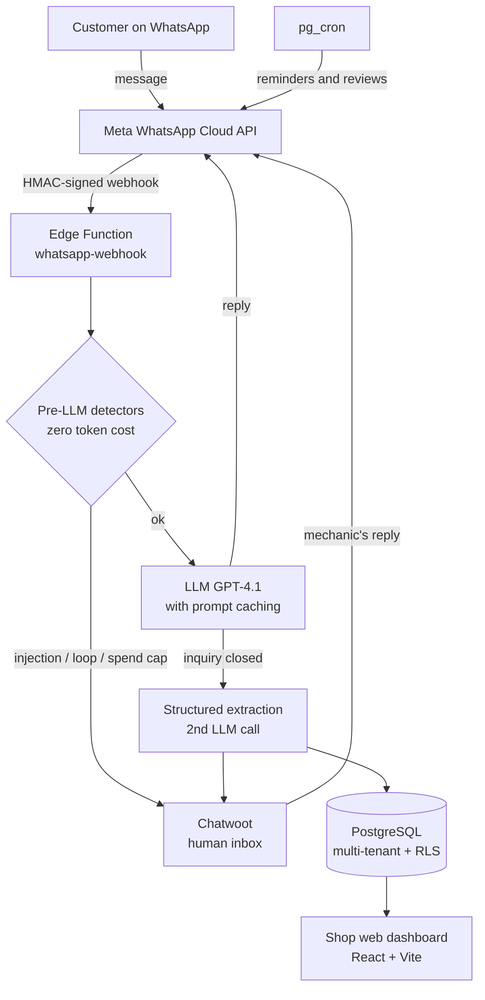

# Holy — AI-powered WhatsApp assistant for auto repair shops

*[Leer en español](README.es.md)*

A multi-tenant platform that answers auto repair shop customers on WhatsApp: it takes the inquiry, collects the car and problem details, proposes an appointment and hands the mechanic a structured work order in their dashboard. When a human is needed, the conversation moves to a human inbox with its full history.

Built by **Lisandro Torre** and **Joaquín Abbona** at [HOLY.systems](https://holysystems.com.ar), Mar del Plata, Argentina, 2026.

> This repository documents the system's architecture and design decisions, with representative code excerpts. The full source code is private and available for review on request.

---

## The problem

A small repair shop gets WhatsApp inquiries all day while the mechanic has their hands in an engine. Replies arrive late, the details end up scattered across the chat and appointments get lost. Holy replies instantly, asks what the mechanic needs to know and records every inquiry as a work order.

## Architecture



**Stack:** TypeScript · React 18 + Vite · Tailwind + shadcn/ui · React Query · Supabase (PostgreSQL, Deno Edge Functions, Row Level Security, pg_cron) · OpenAI GPT-4.1 · self-hosted Chatwoot · Meta WhatsApp Cloud API · Vercel

**AI-assisted development:** Claude Code · Claude Cowork. The whole system was built working with AI agents: we defined the architecture, the decisions and the tests with real conversations; the agents sped up writing the code.

## Technical decisions

**Official Meta API, no middlemen.** Direct integration with the WhatsApp Cloud API instead of a BSP (Twilio, 360dialog) or an unofficial gateway. Middlemen charge per number and per month, which breaks the economics of a product built for small shops.

**Multi-tenant with three layers of isolation.** Each shop only sees its own data: in the database, through Row Level Security filtering by `workshop_id`; in the inbox, with one Chatwoot account per shop; and in the backend functions, with JWT verification and a tenant check before every operation.

**Message batching before replying.** People write on WhatsApp in bursts: "hi", "I have a Gol", "it makes a noise when braking". Replying message by message made the bot sound robotic and answer half the question. We solved it after testing with real conversations: each incoming message waits 10 seconds and then tries to take an atomic lock on the conversation in PostgreSQL. Only one process gets it; that one reads the full history, including every message in the burst, and makes a single model call. The others exit without spending tokens.

**Defenses before the LLM, in code.** Before spending a single token, the webhook runs its own detectors: prompt-injection attempts, cancellations, conversation loops and low-frequency spam that doesn't trigger the rate limit. The system prompt is the secondary defense, not the main one.

**Cost under control by design.** Each shop's variables go at the end of the system prompt to maximize cache hits (75% discount on cached tokens). Each shop has a monthly AI spending cap: once exceeded, the bot turns off and everything goes to human support. Estimated variable cost: about USD 15 per shop per month, between AI and Meta template messages.

**Conversation close with structured extraction.** When the bot finishes collecting the details, it emits a close signal. The system strips it from the visible message, makes a second model call over the last messages only to extract make, model, year, problem and preferred appointment, creates the order in the database and transfers the conversation to the human inbox with the history as a private note.

**Full lifecycle, not just a chat.** Orders move through states (pending → confirmed → in repair → repaired → completed). Scheduled jobs send the appointment reminder 24 hours before, notify when the car is ready and ask for a review the day after the job is done.

**Security.** HMAC verification of every Meta webhook; server-to-server authentication between functions; tokens rotated after an internal audit; personal data masked in logs (phone numbers reduced to their last 4 digits); generic errors toward end users; restrictive CORS and HTTP security headers.

## Code excerpts

**Burst batching + per-conversation lock** (`whatsapp-webhook`)

```ts
// Wait 10 seconds to batch quick messages from the same customer
await new Promise((r) => setTimeout(r, 10000));

// Atomic lock: only one webhook processes the conversation
const { data: lockResult } = await supabase.rpc("try_lock_for_ai", {
  p_conversation_id: conversationId,
});

if (!lockResult) {
  // Another webhook already took the conversation and will read this message from the history
  return jsonResponse(req, { ok: true });
}
```

**Meta signature verification, fail-closed** (`whatsapp-webhook`)

```ts
const metaAppSecret = Deno.env.get("META_APP_SECRET");
if (!metaAppSecret) return jsonResponse(req, { error: "server_misconfigured" }, 500);

const rawBody = await req.text();
const sigHeader = req.headers.get("X-Hub-Signature-256") ?? "";
if (!sigHeader.startsWith("sha256=")) return jsonResponse(req, { error: "unauthorized" }, 401);

const key = await crypto.subtle.importKey(
  "raw", new TextEncoder().encode(metaAppSecret),
  { name: "HMAC", hash: "SHA-256" }, false, ["sign"],
);
const mac = await crypto.subtle.sign("HMAC", key, new TextEncoder().encode(rawBody));
const expectedSig = "sha256=" +
  Array.from(new Uint8Array(mac)).map((b) => b.toString(16).padStart(2, "0")).join("");

// Constant-time comparison so no information leaks through timing
if (!timingSafeEqual(expectedSig, sigHeader)) return jsonResponse(req, { error: "unauthorized" }, 401);
```

## Known limitations and next steps

**The shop has to stop using WhatsApp on its phone.** To connect a number to the Cloud API, the owner must delete their WhatsApp account from the phone. From then on they serve customers from Chatwoot, a tool that works well but that mechanics aren't used to. The alternative is WhatsApp Coexistence, which allows using the app and the API on the same number. We didn't know about it when we started and, when we evaluated it, it didn't fit our audience: Meta requires the business to already use the WhatsApp Business app consistently and for some time, and many shops don't meet that. It's the first improvement for a shop that already uses it.

**Manual onboarding for each shop.** Today, onboarding a shop takes several manual steps across Meta, Chatwoot and the database. The next step is designed: Meta's Embedded Signup, so the mechanic connects their own number from the dashboard in a few minutes and owns their WhatsApp Business account.

**A single WhatsApp Business account for all shops.** It simplifies getting started, but without business verification Meta limits the number of phone numbers. Embedded Signup solves this too, because each shop gets its own account.

## Status

In testing. The product for repair shops is not being sold; HOLY.systems currently focuses on custom software and AI consulting.

## Authors

Designed and developed as a pair, with AI-assisted development (Claude Code and Claude Cowork). Joaquín integrates and versions the repository code.

- **Lisandro Torre** — design and development of the whole system, alongside Joaquín. Also: product, shop onboarding and sales · [github.com/torrelisandro](https://github.com/torrelisandro)
- **Joaquín Abbona** — design and development of the whole system, alongside Lisandro. Also: code integration and version control · [github.com/joaquinabbona](https://github.com/joaquinabbona)
